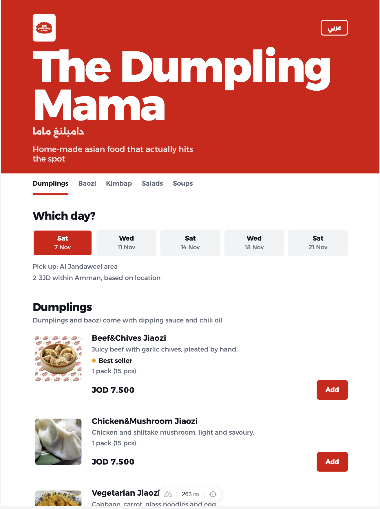
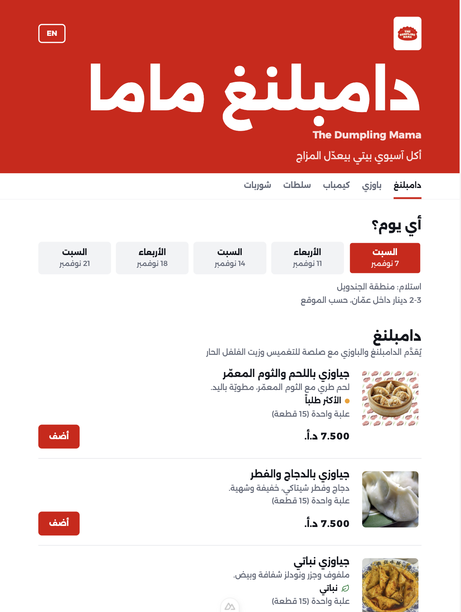
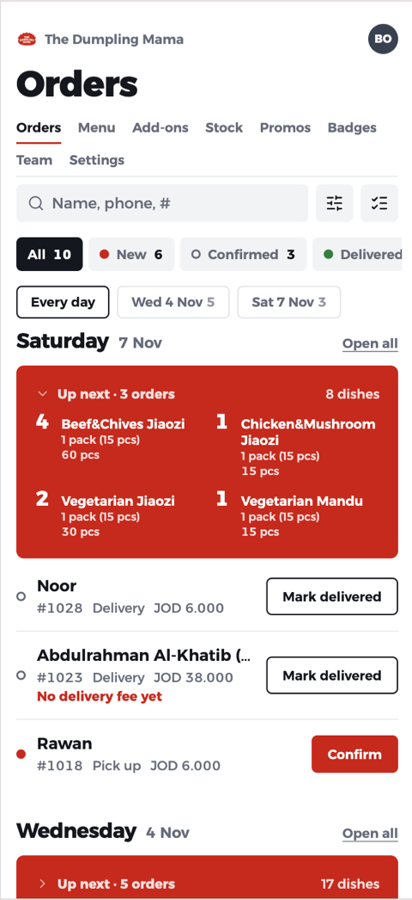

# Hi, I'm Bashar 👋

Full-stack engineer working remotely (UTC+3). I build the shared foundations a team ships on (component kits, store factories, base controllers) and the products that sit on top of them.

**Vue / Nuxt · TypeScript · Laravel · PostgreSQL** · Arabic and English · Canadian and Jordanian citizen · open to remote roles

[LinkedIn](https://www.linkedin.com/in/bashar-othman)

---

## basta.my: ordering for home food businesses

> In a live pilot with its first shop, [The Dumpling Mama](https://dumpling-mama.basta.my), since September 2026. Still in active development. The code is private; this page describes how it's built.

Home cooks in Jordan take orders through Google Forms, WhatsApp and spreadsheets. basta.my gives each one a real shop: its own subdomain, a menu with photos, delivery and pickup days with cutoffs, checkout, and an admin for the owner and staff.

I designed, built and run it alone, working with AI coding tools under strict review and testing rules.

  
  &nbsp;
  

The same shop in English and Arabic

### Stack

Nuxt 4 · Vue 3 · TypeScript · PostgreSQL (Neon) · Drizzle ORM · zod · Tailwind CSS 4 · Vitest
Deployed from GitHub Actions to Railway, with Cloudflare R2 for photos and Resend for email.

### Problems worth talking about

- **Checkout that can't oversell.** Two customers can try to buy the last item, or use the last promo code, at the same moment. Checkout takes a database lock per shop and day, then recomputes every price, stock cap and promo inside one transaction. A test runs real parallel connections to prove it.
- **Many shops, one app.** Every shop lives on its own subdomain. Middleware sends each address to the right place: shop pages only on a shop's subdomain, sign-up only on the main domain, and `www` and the hosting domain redirected.
- **Roles enforced on the server.** Owners manage money, menu and settings; staff handle today's orders. Every admin endpoint names the lowest role it allows, and a lint rule fails the build if one forgets.
- **Money with 3 decimals.** The Jordanian dinar has 3 decimal places, so all money is stored as integers in minor units. A lint rule blocks the usual `/ 100` and `.toFixed(2)` mistakes.
- **Passwordless sign-in.** Email codes are hashed, expire in 10 minutes, are rate-limited, and only work in the browser that asked for them.
- **Arabic, right to left.** Full Arabic and English. Dates and phone numbers are isolated so they don't flip in right-to-left text, a bug the tests missed and the browser caught.
- **Order filters in the URL.** One schema is shared by the page, the URL and the API, and paging uses a cursor so new orders don't cause skipped or repeated rows.
- **Migrations without downtime.** New columns ship on their own; removing one takes two deploys, so the live shop never meets a column it doesn't expect.

  

The owner's Orders page (demo orders)

### How it's kept honest

- About 200 test files: unit, component, real-database and HTTP tests
- 12 custom lint rules that each block a whole class of bug (money, dates, right-to-left layout, auth, validation)
- CI runs typecheck, tests and every lint rule before anything deploys

### Recent work

- **Oct–Nov 2026:** redesigned every admin page and the customer shop, each one mocked up first and built to match
- **Oct 2026:** add-ons (extras on menu items); shop sign-up and approval opened on basta.my
- **Sep 2026:** first shop live

---

## Before basta.my

**Software Engineer, Ordonsoft** (contracted through Aji, Saudi Arabia) · May 2024 – Jul 2026
Wrote most of the frontend of a multi-tenant project management and GRC platform (Nuxt 2, Vuex, Vuetify, Laravel), white-labelled in four languages and piloted by companies including Zain and OQ. I built the shared table, form and store layers the rest of the team built on: `CustomTable` is used in 260+ files, and my store factory generates 276 of the app's 357 Vuex stores.

**Assistant Instructor, General Assembly London** · 2022 – 2023
Three cohorts of the Software Engineering Immersive: daily code review, and one-on-one teaching in JavaScript, React, Python and databases.
